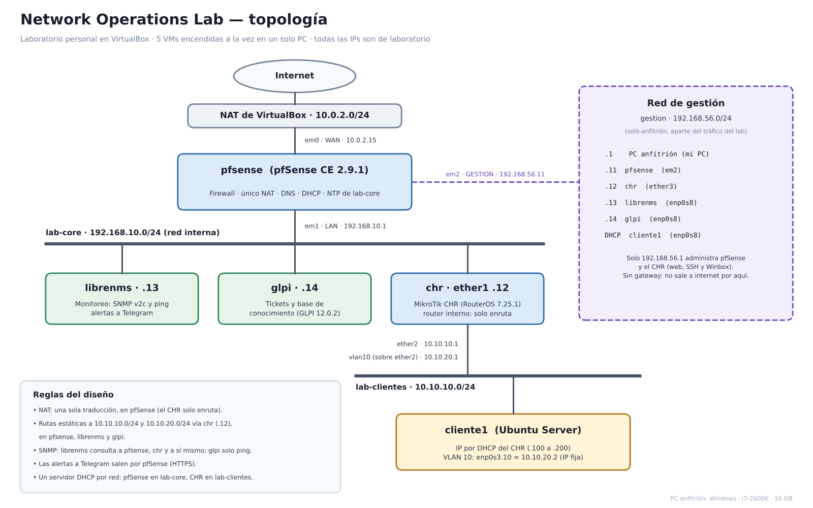
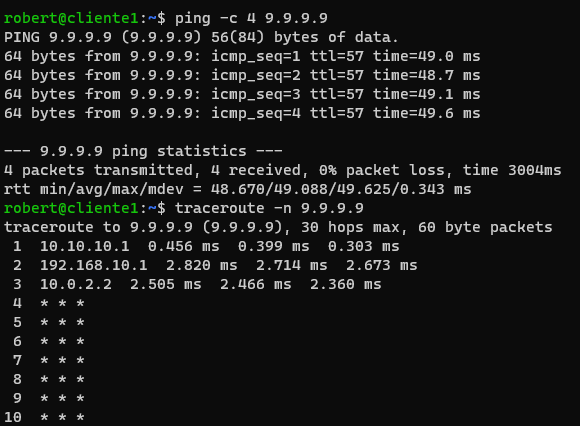
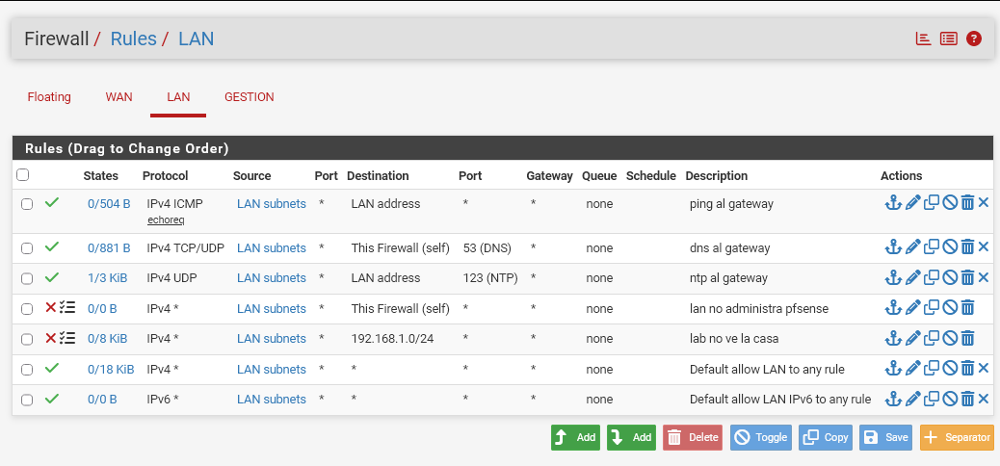
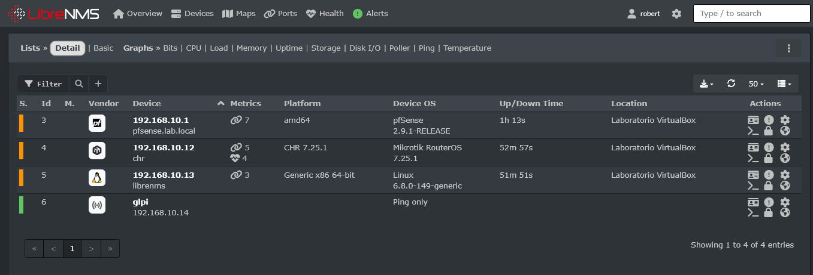
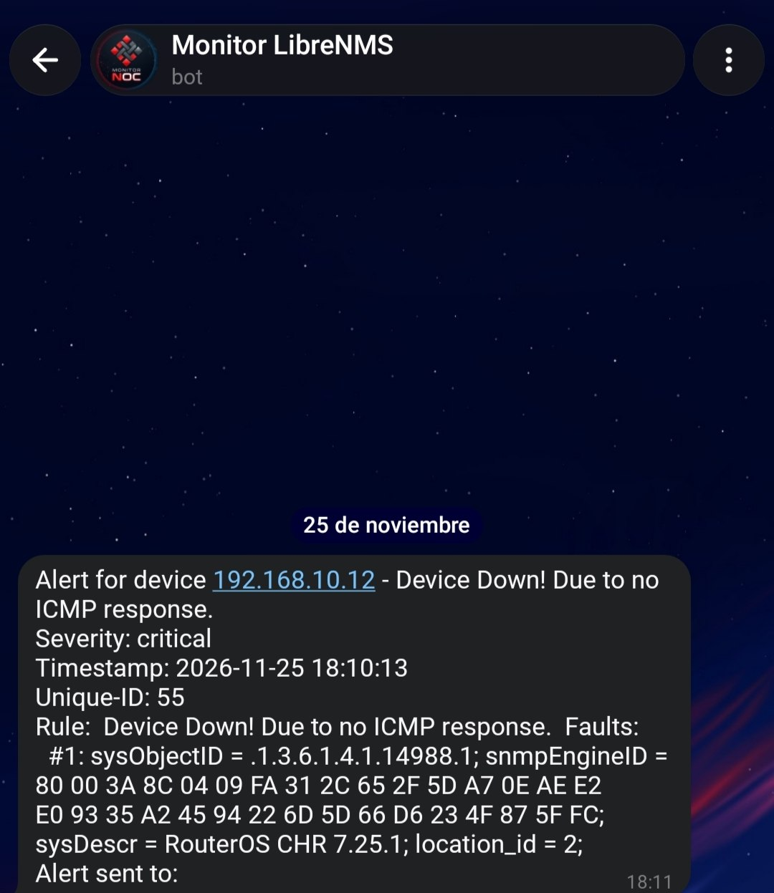
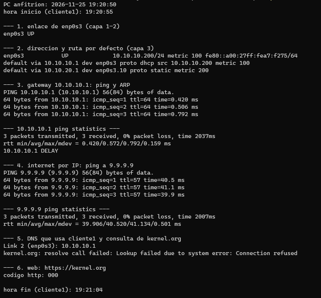
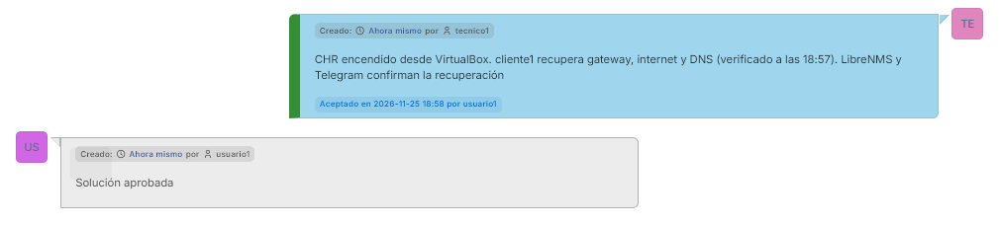

# Network Operations Lab

Mini NOC (centro de operaciones de red) virtual en VirtualBox: una red pequeña protegida por **pfSense**, con un router **MikroTik CHR** detrás, monitoreada por **LibreNMS** y con los incidentes registrados en **GLPI**. El hilo conductor es el ciclo de trabajo de un NOC y de soporte IT: **detectar, diagnosticar, resolver y documentar**.

> **Aviso de alcance.** Es un laboratorio personal en VirtualBox, no una red de producción: **no es experiencia laboral**. Seguí guías y usé un asistente de IA. Lo que no pude explicar o comprobar está marcado como "no verificado" o "causa no determinada". Los usuarios, los tickets y los artículos son de prueba, y los fallos de los incidentes los provoqué yo.

## English summary

A small virtual NOC (Network Operations Center) built in VirtualBox: a **pfSense** firewall at the edge, a **MikroTik CHR** router behind it, **LibreNMS** for monitoring (SNMP v2c, ping, Telegram alerts) and **GLPI** for tickets and a knowledge base. Five VMs run at the same time on one Windows PC. The goal was to practice the NOC cycle: detect, diagnose, resolve, document.

What I did: designed the addressing and the boot order; put NAT only on pfSense; wrote and ran a firewall and connectivity test matrix (it found real gaps, which I fixed and tested again); tested a config restore and reboots; and ran three simulated incidents (internal router down, broken DNS, edge firewall down). Each incident has a timeline, a GLPI ticket and a knowledge-base article.

Scope: this is a lab, not production experience. I followed guides and used an AI assistant. When I could not explain something, I wrote "cause not determined". The documentation is in Spanish, and every folder has its own README.

## Topología

| VM | Rol | Red principal | Gestión |
|---|---|---|---|
| `pfsense` | Borde: firewall, único NAT, DNS, DHCP y NTP de `lab-core`; SNMP solo para `librenms` | `192.168.10.1` | `192.168.56.11` |
| `chr` | MikroTik CHR (RouterOS 7.25.1): router interno, DHCP y relevo DNS de `lab-clientes`, filtra clientes hacia servidores | `192.168.10.12` y `10.10.10.1` | `192.168.56.12` |
| `librenms` | Monitoreo: SNMP v2c, ping y alertas a Telegram | `192.168.10.13` | `192.168.56.13` |
| `glpi` | Tickets y base de conocimiento (GLPI 12.0.2) | `192.168.10.14` | `192.168.56.14` |
| `cliente1` | Cliente de prueba, con VLAN 10 persistente | `10.10.10.x` (DHCP del CHR) y `10.10.20.2` (VLAN 10) | DHCP de VirtualBox |

Las cinco VMs (1 a 2 GB de RAM cada una) caben encendidas a la vez en un PC con Windows, i7-2600K y 16 GB: unos 70 % de memoria y menos de 20 % de CPU (medido el 20/11/2026). Direccionamiento completo en [docs/direccionamiento.md](docs/direccionamiento.md).

## Qué hay en cada carpeta

| Carpeta | Contenido |
|---|---|
| [docs/](docs/) | [Arquitectura](docs/arquitectura.md) (decisiones y lo que no se verificó), [direccionamiento](docs/direccionamiento.md) y [orden de encendido](docs/orden-de-encendido.md) |
| [pfsense/](pfsense/readme.md) | SSH por gestión, NAT, DNS, reglas de la LAN con su prueba, restauración, reservas DHCP y NTP. Copia de la configuración sin secretos en [configs/](pfsense/configs/config-pfsense-redactado.xml) (no sirve para restaurar). El laboratorio original: [primer-laboratorio.md](pfsense/primer-laboratorio.md) |
| [mikrotik/](mikrotik/readme.md) | MikroTik CHR: DHCP, VLAN, límite de velocidad, usuarios y servicios, con el historial de cambios |
| [librenms/](librenms/readme.md) | SNMP v2c, dispositivos, gráficas y alertas por Telegram. El laboratorio original: [primer-laboratorio.md](librenms/primer-laboratorio.md) |
| [glpi/](glpi/readme.md) | GLPI: instalación, ciclo de un ticket y base de conocimiento |
| [integracion/](integracion/readme.md) | Cómo se conectan las piezas (NAT, rutas, DNS, VLAN) y la [matriz de pruebas](integracion/pruebas.md) |
| [incidentes/](incidentes/readme.md) | Tres incidentes simulados, cada uno con línea de tiempo, ticket y artículo |

Para leerlo en orden: [arquitectura](docs/arquitectura.md), luego [integración](integracion/readme.md), las [pruebas](integracion/pruebas.md) y los [incidentes](incidentes/readme.md).

## Qué se probó

Cada README marca qué está verificado y qué no. Lo esencial:

- **Conectividad de punta a punta.** `cliente1` sale a internet pasando por el CHR y pfSense (se demuestra con `traceroute`). El NAT es una sola traducción, en pfSense. El DNS va en cadena: `cliente1` → CHR → pfSense → `10.0.2.3`. La VLAN 10 sobrevive a un reinicio.
- **Matriz esperado/real** ([pruebas](integracion/pruebas.md)). 28 filas iniciales: 27 coinciden y 1 coincidió en parte la primera vez; al repetirla coincidió. Tras los cambios, 13 filas y todas coinciden. Anoté lo esperado antes de ejecutar cada bloque.
- **Hallazgos que corregí.** Los clientes llegaban a todos los servicios del CHR y al SSH de `glpi` y `librenms`; el CHR quedó con 3 reglas de `forward`, 4 servicios desactivados y 2 restringidos. La gestión de pfSense admitía toda la red de gestión y no solo mi PC; ahora solo `192.168.56.1`.
- **SNMP desde una IP no autorizada** no obtiene respuesta en pfSense (con log), CHR y `librenms`; en estos dos últimos la causa se deduce de la configuración.
- **Restauración y reinicios.** La restauración de pfSense se probó con un cambio real y vuelta atrás. pfSense reinició en 92 s; el CHR en 72 s y, en frío, en 44 s como máximo, con la configuración intacta.
- **Monitoreo y alertas.** LibreNMS chequea ICMP cada 5 minutos y el aviso a Telegram sale 49 a 55 s después de detectar el cambio (7 transiciones observadas).

## Los tres incidentes (25/11/2026)

| # | Qué provoqué | Cómo se detectó | Resultado |
|---|---|---|---|
| [01](incidentes/incidente-01.md) | CHR apagado (39 min 29 s) | LibreNMS marcó Down y avisó por Telegram 49 s después | Diagnóstico de lo físico a lo lógico; los clientes perdieron gateway, internet y DNS |
| [02](incidentes/incidente-02.md) | DNS del CHR desactivado (15 min 43 s) | Por reporte de usuario; LibreNMS no alertó (solo vigila ping) | Hay ping por IP pero no abren páginas; causa hallada con `nc` al puerto 53 y `:resolve` en el CHR |
| [03](incidentes/incidente-03.md) | pfSense apagado (9 min 6 s) | LibreNMS marcó Down, pero **el aviso a Telegram no salió** | La alerta depende de pfSense; al volver solo llegó la recuperación |

### Capturas clave

<table>
  <tr>
    <td align="center"> Traceroute de <code>cliente1</code> por el CHR y pfSense</td>
    <td align="center"> Reglas de la LAN en pfSense</td>
    <td align="center"> Dispositivos en LibreNMS</td>
  </tr>
  <tr>
    <td align="center"> Alerta de Telegram: CHR caído</td>
    <td align="center"> Síntomas del DNS roto</td>
    <td align="center"> Ticket cerrado en GLPI</td>
  </tr>
</table>

## Qué no se hizo

- **Filtrado parcial en el CHR.** Solo se filtra el tráfico de clientes hacia servidores, sin regla final de descarte. El DNS del CHR queda abierto en todas sus interfaces. El rechazo de Winbox no tiene prueba directa y no probé restaurar la configuración del CHR desde un `export` o `backup`.
- **pfSense.** La LAN permite todo hacia internet (no se restringió por puertos); SSH solo con contraseña, sin llaves; IPv6 sin probar; el SSH desde la LAN con el antilockout activo no se probó.
- **SNMP.** Solo v2c, con una comunidad compartida por tres equipos y sin cifrar; sin v3.
- **Alertas.** Solo la regla de caída por ICMP notifica. LibreNMS no vigila DNS. No hay un camino de avisos que no dependa de pfSense: si pfSense cae, el aviso no sale (probado en el [incidente 03](incidentes/incidente-03.md)).
- **GLPI.** Sin entidades, categorías, SLA, notificaciones por correo, HTTPS, inventario con agentes ni plugins.
- **Pruebas.** Solo hay un cliente. No medí rendimiento ni el efecto del tope de 1 Mbps de la licencia gratuita del CHR.
- **Causas no determinadas.** Varias rarezas quedaron sin explicar y están listadas en [arquitectura, sección 10](docs/arquitectura.md#10-qué-no-se-verificó).

## Lo que aprendí

- **Probar antes de creer.** La matriz de pruebas encontró huecos reales en una red que yo daba por cerrada; los corregí y volví a probar.
- **Un solo NAT.** Con doble traducción, pfSense veía todo como `192.168.10.12` y no distinguía clientes. El borde traduce y el núcleo enruta.
- **El mismo síntoma tiene causas distintas.** "No abre páginas" dio `No route to host`, `Connection refused` y `SERVFAIL` según el fallo; el texto del error indica dónde mirar.
- **Detectar y avisar son caminos distintos.** LibreNMS vio la caída de pfSense, pero el aviso pasa por pfSense: un canal de avisos que depende del equipo vigilado es un punto único de fallo.
- **Un monitoreo que solo hace ping no ve todo.** Un DNS roto pasó sin alerta.
- **Los errores pueden imprimir secretos.** El token del bot de Telegram apareció en la URL de un error. Lo regeneré y revisé las salidas antes de copiarlas.
- **Escribir lo esperado antes de ejecutar** muestra dónde me equivoco, y marcar "causa no determinada" es más honesto que inventar una explicación.

## Cómo se construyó

Los laboratorios individuales de LibreNMS, MikroTik, GLPI y pfSense son del 17 al 19/11/2026. Después, por etapas: diseño y revisión (20/11), pfSense a fondo (21/11), integración de la red (22/11), monitoreo (23/11), pruebas de firewall (24/11), incidentes (25/11) y publicación.

## Versiones y herramientas

pfSense CE 2.9.1 · MikroTik CHR con RouterOS 7.25.1 (licencia gratuita) · LibreNMS sobre Ubuntu Server 24.04 (Nginx, PHP 8.4, MariaDB) · GLPI 12.0.2 sobre Ubuntu Server 24.04 (Apache, PHP 8.3, MariaDB) · `cliente1` con Ubuntu Server · VirtualBox · PowerShell con OpenSSH.

Autor: Robert Duran (GitHub: Stark-29). Otro proyecto: [MS Vandamme](https://github.com/Stark-29/red-crucero-packet-tracer), una red de crucero en Packet Tracer.

Última actualización: 26/11/2026.
